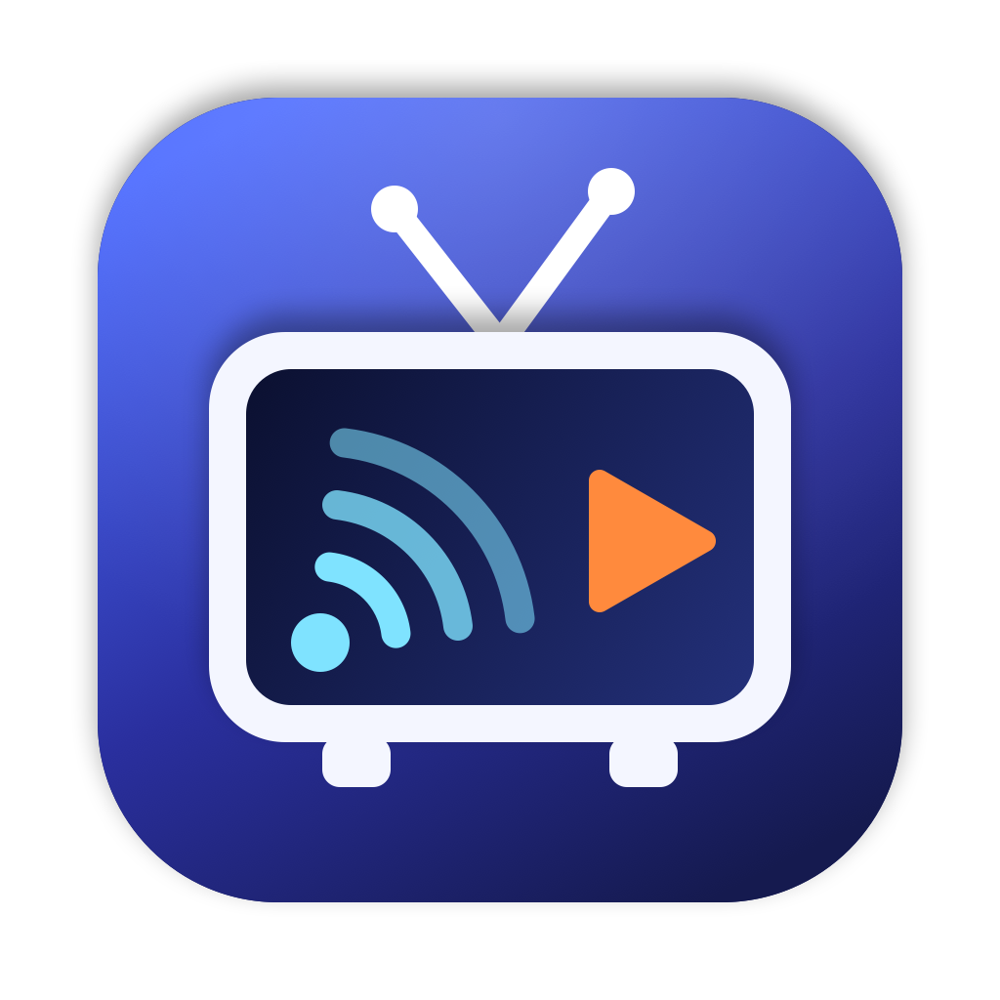
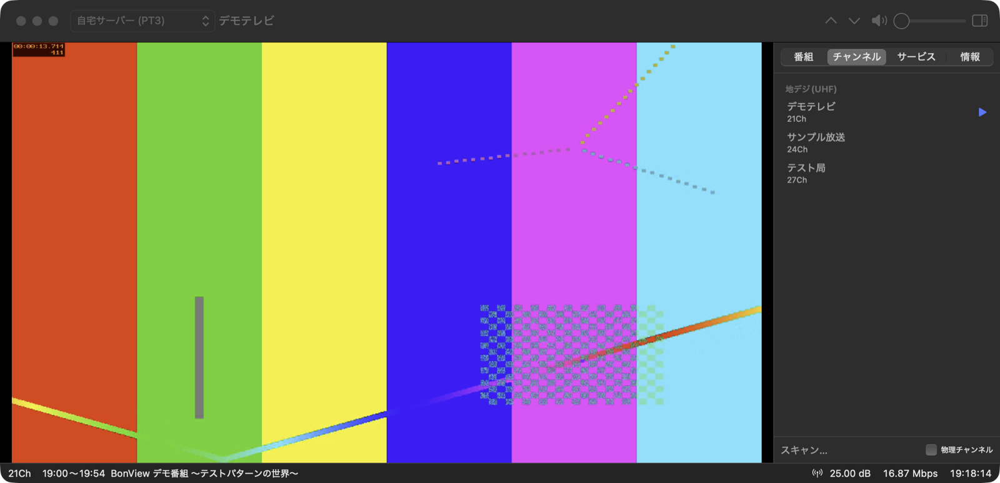
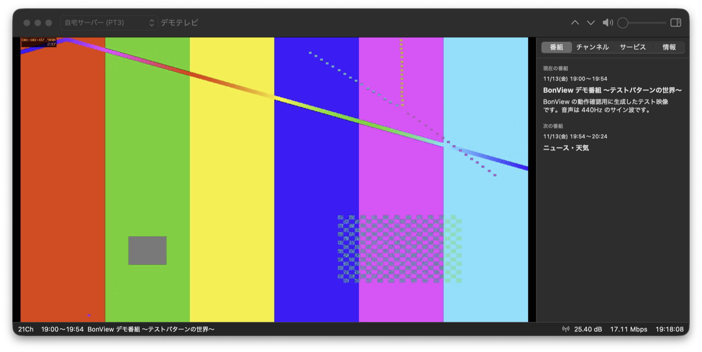

<p align="center">
  
</p>

<h1 align="center">BonView</h1>

<p align="center">
  Windows / Linux の BonDriver サーバーにネットワーク越しに接続して、<br>
  日本のデジタル放送（ISDB-T / ISDB-S）を macOS で視聴するネイティブアプリ
</p>

---

Mac に直接つなげられるテレビチューナーはほとんどありません。BonView は、チューナーを挿した Windows / Linux マシンで動いている **BonDriverProxy(Ex)** または **BonDriverTunnel** に LAN 経由で接続し、届いた MPEG-2 TS を Mac 上でデコードして表示します。

Mac 側にドライバーやカードリーダーは要りません。

<p align="center">
  
</p>
<p align="center">
  
</p>
<p align="center"><sub>※ 画面は付属スクリプトで生成したテスト映像（架空の局・番組）をモックサーバーから配信したものです。</sub></p>

```
┌──────────── Windows / Linux ────────────┐            ┌──────── Mac ────────┐
│ チューナー → BonDriver_xxx.dll            │            │                     │
│               ↓                          │  TCP/LAN   │  BonView            │
│ BonDriverProxyEx.exe  (1192/tcp)  ───────┼──────────▶ │   TS 分離 → デコード  │
│   または BonDriverTunnel.exe (1193/tcp)    │            │   → 映像・音声の同期表示 │
└──────────────────────────────────────────┘            └─────────────────────┘
```

## 目次

- [特徴](#特徴)
- [動作環境](#動作環境)
- [ビルドとインストール](#ビルドとインストール)
- [サーバー側の準備](#サーバー側の準備)
- [BonView の設定](#bonview-の設定)
- [使い方](#使い方)
- [コマンドラインツール bdpcat](#コマンドラインツール-bdpcat)
- [チューナーなしで試す](#チューナーなしで試す)
- [トラブルシューティング](#トラブルシューティング)
- [構成](#構成)
- [今後の予定](#今後の予定)
- [注意事項](#注意事項)
- [ライセンス](#ライセンス)

## 特徴

- **2 種類のサーバーに対応**
  - BonDriverProxy / BonDriverProxyEx / BonDriverProxy_Linux（BdpPacket プロトコル互換、チャンネルロック、Wake on LAN）
  - BonDriverTunnel（xtne6f 版。切断時の自動再接続とコマンド再送に対応。BonDriverLocalProxy との多段接続も可）
  - Windows 用の `BonDriver_Proxy.ini`、Linux 用の `BonDriver_Proxy.so.conf`、BonDriver_Tunnel 用の `BonDriver_*.ini` をそのまま読み込めます。
- **ネイティブのデコードと表示**
  - H.264 / HEVC は VideoToolbox でハードウェアデコードします。
  - MPEG-2 は FFmpeg でデコードし、bwdif でインターレースを解除して 59.94p で表示します。
  - 映像と音声は `AVSampleBufferRenderSynchronizer` で同期させます。ネットワークの揺らぎは自動で吸収します。
- **放送の情報を表示**
  - PAT / PMT / SDT / EIT（現在と次の番組）/ TOT を解析し、局名・番組名・放送時刻を表示します。文字は ARIB STD-B24 の 8 単位符号に対応しています。
  - 複数のサービス（マルチ編成）、複数の音声、二重音声（主 / 副 / 主+副）を切り替えられます。
  - ARIB 字幕を映像の下部に表示します（文字のみ。位置・色・外字（DRCS）は未対応で、ルビは省略します）。ツールバーの字幕ボタンか ⌥⌘C で切り替えます。
- **チャンネルスキャン**
  - 全チャンネルを順に選局し、放送のあるチャンネルだけを局名一覧にします。
- **HaijinW 版 BonDriverProxyEx のサーバー側スクランブル解除（B25）に対応**
  - 解除を要求するフラグを送ります。詳しくは [B25 について](#bondriverproxyex-を使う場合推奨) を参照してください。
- **TS ファイルの再生**
  - 録画済みの `.ts` / `.m2ts` を開けます。Finder の「このアプリケーションで開く」や、`BonView.app/Contents/MacOS/BonView file.ts` からも開けます。
- **コマンドラインクライアント `bdpcat`**
  - チャンネル一覧の表示、TS の保存、ストリーム情報の表示、チャンネルスキャンができます。

## 動作環境

| | |
|---|---|
| OS | macOS 14 Sonoma 以降（Apple シリコン / Intel） |
| ビルド | Xcode 16 以降（Swift 6 ツールチェーン） |
| ライブラリ | [FFmpeg](https://ffmpeg.org/)（Homebrew 版で動作確認） |
| サーバー | BonDriverProxyEx / BonDriverProxy / BonDriverProxy_Linux / BonDriverTunnel のいずれか |

> [!NOTE]
> Homebrew の FFmpeg は、インストールした macOS 向けにビルドされています。ビルドした `.app` は、基本的にビルドした Mac（と同じ以降のバージョンの macOS）でしか動きません。

## ビルドとインストール

```bash
brew install ffmpeg
git clone https://github.com/shigeya-t/bonview.git
cd bonview
scripts/bundle.sh            # build/BonView.app を作成（アドホック署名）
open build/BonView.app
```

- `/Applications` に置きたい場合は `build/BonView.app` をコピーしてください。
- FFmpeg が別の場所にある場合は、`FFMPEG_PREFIX=/path/to/ffmpeg scripts/bundle.sh` のように指定します。
- バンドル ID は `BUNDLE_ID=io.github.yourname.BonView scripts/bundle.sh` で変えられます。
- アイコンは `swift scripts/make_icon.swift` で作り直せます。

開発中は次のコマンドも使えます。

```bash
swift build                  # すべてのターゲットをビルド
swift test                   # ユニットテスト（ffmpeg CLI があればデコードテストも実行）
swift run BonView            # .app を作らずに起動
```

## サーバー側の準備

チューナーをつないだ Windows（または Linux）マシンに、次のどちらかを用意します。

### BonDriverProxyEx を使う場合（推奨）

[HaijinW 版 BonDriverProxyEx](https://github.com/HaijinW/BonDriverProxyEx) を使うと、**サーバー側でスクランブルを解除**したうえで Mac に送れます。

1. `BonDriverProxyEx.exe` と同じフォルダに、`B25Decoder.dll` と使いたい BonDriver を置きます。32bit / 64bit は exe と揃えてください。
2. exe と同じ名前の `BonDriverProxyEx.ini` を作ります。

```ini
[OPTION]
; 既定の 127.0.0.1 では外部から接続できません。サーバーの LAN 側 IP を指定します
ADDRESS=192.168.0.10
PORT=1192
; サーバー側でスクランブルを解除
B25=1
STRIP=1
EMM=0

[BONDRIVER]
; グループ名;DLL;DLL…  ← 空いているチューナーが自動で使われます
00=PT-T;BonDriver_PT-T0.dll;BonDriver_PT-T1.dll
01=PT-S;BonDriver_PT-S0.dll;BonDriver_PT-S1.dll

[SYSTEM]
PACKET_FIFO_SIZE=64
TS_FIFO_SIZE=64
TSPACKET_BUFSIZE=192512
```

3. Windows ファイアウォールで TCP 1192 の受信を許可し、`BonDriverProxyEx.exe` を起動します。

> [!IMPORTANT]
> HaijinW 版は、**サーバーの ini とクライアントの両方で B25 が有効なときだけ**スクランブルを解除します。BonView は既定でクライアント側の要求フラグを送ります（パケットヘッダーの予約領域 bit0。SetChannel2 で送信）。他のサーバーはこのフラグを無視します。

#### BonDriverLocalProxy と組み合わせる

Windows 側で [BonDriverLocalProxy](https://github.com/xtne6f/BonDriverLocalProxy) を使ってチューナーを共有している場合は、`[BONDRIVER]` に LocalProxy のクライアント DLL を書きます。

```
C:\DTV\
├─ BonDriverProxyEx\
│   ├─ BonDriverProxyEx.exe / BonDriverProxyEx.ini / B25Decoder.dll
│   ├─ BonDriver_Proxy_PT-T0.dll     ← LocalProxy のクライアント DLL をリネームしたもの
│   └─ BonDriver_Proxy_PT-T1.dll
└─ BonDriverProxy\
    ├─ BonDriverLocalProxy.exe
    └─ BonDriver_PT-T0.dll / BonDriver_PT-T1.dll   ← 本物の BonDriver
```

```ini
[BONDRIVER]
00=PT-T;BonDriver_Proxy_PT-T0.dll;BonDriver_Proxy_PT-T1.dll
```

- 名前の `BonDriver_Proxy?_` の `?` は優先度です（なし < 0–9 < A–Z）。
- 他のアプリ（Windows 版の視聴ソフトや録画ソフト）と同じ優先度にすると、同時には接続できません。

### BonDriverTunnel を使う場合

[BonDriverTunnel](https://github.com/xtne6f/BonDriverTunnel)（xtne6f 版）は、BonDriver をそのままネットワークに転送する軽量なサーバーです。

- `BonDriverTunnel.exe` と同じフォルダに BonDriver を置いて起動します（既定ポートは 1193）。
- **スクランブル解除はしません。** 解除済みの TS を出す BonDriver と組み合わせてください。
- 1 つの BonDriver につき、同時に接続できるクライアントは 1 つだけです。チャンネルロックはありません。
- BonDriverLocalProxy と組み合わせる場合は、LocalProxy のクライアント DLL（例: `BonDriver_Proxy0_PT-T.dll`）を exe と同じフォルダに置きます。BonView 側では ORIGIN に `Proxy0_PT-T` を指定します。

### Linux（BonDriverProxy_Linux）

[BonDriverProxy_Linux](https://github.com/u-n-k-n-o-w-n/BonDriverProxy_Linux) の `BonDriverProxy` サーバーにも接続できます。BonDriver には `.so` のフルパス（例: `/usr/local/lib/BonDriver_LinuxPT-T0.so`）を指定します。

## BonView の設定

設定（⌘,）の「BonDriver」タブで、＋を押してサーバーを追加します。

| 項目 | BonDriverProxy(Ex) | BonDriverTunnel |
|---|---|---|
| アドレス / ポート | サーバーの IP と 1192 | サーバーの IP と 1193 |
| BonDriver | ProxyEx ではグループ名（例 `PT-T`）、Proxy では DLL 名（例 `BonDriver_PT-T0.dll`） | ORIGIN：`BonDriver_*.dll` の `*`（例 `PT-T`） |
| その他 | チャンネルロック、Wake on LAN、B25 解除要求 | 送受信タイムアウト |

「読み込み…」から既存の `BonDriver_Proxy.ini` / `.so.conf` / BonDriver_Tunnel 用の ini を取り込めます。どの方式かは自動で判別します。

再生タブでは、ハードウェアデコードとインターレース解除の有効 / 無効を切り替えられます。

## 使い方

1. ツールバー左のメニューでサーバーを選ぶと接続し、前回見ていたチャンネルを選局します。
2. 初めて接続したときは、**チューナー > チャンネルスキャン…** で放送されている局を探してください。
   - スキャン後は、チャンネルパネルが局名の一覧になります。行をつまんで（ドラッグして）並べ替えられ、⌘↑ / ⌘↓ もその順に切り替わります。右クリックメニューの「上へ移動」「先頭へ移動」などでも並べ替えられます。
   - パネル下の「物理チャンネル」にチェックを入れると、BonDriver の物理チャンネルと局名の一覧になります。
     ここで「非表示」にチェックを入れた局は、チャンネル一覧と ⌘↑ / ⌘↓ の対象から外れます。
   - 局名の前には、テレビと同じ 3 桁番号（081、082 など）を表示します。地デジではネットワーク情報（NIT）のリモコンキー番号から、BS / CS ではサービス ID から求めます。以前のバージョンでスキャンした結果には番号が出ないので、再スキャンしてください。
   - マルチ編成用のサブチャンネル（同じ物理チャンネルでメインと同じ名前の 082、083 など）は、スキャンで初めて見つかったときに自動で非表示にします。必要なら物理チャンネル一覧で表示に戻せます。
3. 右側のパネルには次の 4 つがあります。
   - **番組**：現在と次の番組
   - **チャンネル**：選局
   - **サービス**：サービス、音声、二重音声の切り替え
   - **情報**：コーデック、エラー数など

### キーボードショートカット

| 操作 | キー |
|---|---|
| 前 / 次のチャンネル | ⌘↑ / ⌘↓ |
| 接続 / 切断 | ⌘K / ⇧⌘K |
| TS ファイルを開く | ⌘O |
| 消音 | ⌥⌘M |
| 音量を上げる / 下げる | ⌘= / ⌘- |
| 字幕の表示切替 | ⌥⌘C |
| パネルの表示切替 | ⌥⌘P |
| 画面サイズ 20% / 25% / 33% / 50% / 67% / 75% / 100% / 150% / 200% | ⌘1 〜 ⌘9（この順） |
| 設定 | ⌘, |
| 全画面 | 映像をダブルクリック |

ツールバーのサイズ表示（例: `1920 x 1080 (100 %)`）は、映像の解像度と今の表示倍率です。クリックすると 20%〜200%（1/3、2/3 を含む 9 段階）を選べ、映像がその大きさになるようにウィンドウの大きさが変わります。100% は映像の解像度（1440×1080 の地デジなら 1920×1080）を 1 ピクセル = 1 ポイントで表示する大きさです。画面に収まらない場合は、収まる大きさまで縮めます。

ウィンドウを閉じると再生を止めて切断します。ウィンドウを開き直すと、もう一度接続します。

### ステータスバーの見方

`21Ch  13:50〜15:42 番組名 …   29.74 dB  17.16 Mbps  D:0 E:0  15:15:00`

| 表示 | 意味 |
|---|---|
| dB | 信号レベル（BonDriver が返す値） |
| Mbps | 受信ビットレート |
| D | ドロップ（連続性カウンターの不連続）の数 |
| E | エラーパケット（TEI）の数。チューナーで訂正できなかった受信エラーです |
| 時刻 | 放送の時刻（TOT） |

D と E は、選局後に最初の PAT を受け取ってから数え始めます。

## コマンドラインツール bdpcat

GUI を使わずに、接続やストリームを確認できます。

```bash
swift run bdpcat -c BonDriver_Proxy.ini --list                          # チャンネル一覧
swift run bdpcat -a 192.168.0.10 -d PT-T --scan --space 0               # チャンネルスキャン
swift run bdpcat -a 192.168.0.10 -d PT-T --space 0 --channel 8 -t 10 --info -o out.ts
swift run bdpcat -a 192.168.0.10 -d PT-T --space 0 --channel 8 -o - | ffplay -
swift run bdpcat --tunnel -a 192.168.0.10 -d PT-T --list                # BonDriverTunnel
```

| オプション | 説明 |
|---|---|
| `--tunnel` | BonDriverTunnel で接続する（既定のポートは 1193） |
| `-c FILE` | ini / conf を読み込む（Tunnel 用の ini は自動で判別） |
| `-a` / `-p` / `-d` | アドレス / ポート / BonDriver（Tunnel では ORIGIN） |
| `--lock N` | チャンネルロックの優先度（0–255） |
| `--no-b25` | B25 解除を要求しない |
| `--list` / `--scan` | チャンネル一覧 / チャンネルスキャン |
| `--space S --channel C` | 選局 |
| `-t SEC` / `-o FILE\|-` / `--info` | 受信時間 / 出力先 / 終了時にサービス・エラー数を表示 |

## チューナーなしで試す

付属のモックサーバーは、TS ファイルをチャンネルとして配信します。BonDriverProxy と BonDriverTunnel の両方のプロトコルに対応し、PCR に合わせて実時間で送ります。

```bash
scripts/mock_bdp_server.py --port 1192 --tunnel-port 1193 --origin PT-T ch1.ts ch2.ts
```

手元に TS ファイルがない場合は、`scripts/make_demo_ts.py` でデモ用の TS を作れます。ffmpeg のテスト映像に、ARIB 形式の局名（SDT）、番組情報（EIT 現在 / 次）、時刻（TOT）、リモコンキー番号（NIT、`--key` 指定時）を加えたものです。`--captions` を付けると、2 秒ごとに変わる字幕も入ります。

```bash
scripts/make_demo_ts.py 21Ch.ts --sid 1056 --key 8 --name "デモテレビ" --title "デモ番組" --next "ニュース"   # 081
scripts/make_demo_ts.py 24Ch.ts --sid 1072 --key 7 --name "サンプル放送" --pattern smptehdbars --tone 660   # 071
scripts/mock_bdp_server.py --space-name "地デジ(UHF)" 21Ch.ts 24Ch.ts    # チャンネル名はファイル名（拡張子なし）
```

BonView ではアドレス `127.0.0.1` に接続します。BonDriver は任意の名前（例 `BonDriver_Mock.dll`）で、Tunnel では ORIGIN に `PT-T` を指定します。

## トラブルシューティング

**「スクランブルが解除されていません」と表示される**
- サーバーの ini が `B25=1` になっているか、`B25Decoder.dll` が exe と同じフォルダにあるか、32 / 64bit が一致しているかを確認してください。
- BonView 側の「サーバーにスクランブル解除を要求 (B25)」がオンになっているかも確認してください。
- BonDriverTunnel はスクランブルを解除しません。

**信号が 0 dB のまま、E（エラー）が増え続ける**
- そのチャンネルでは放送が受信できていません。チャンネルスキャンで、放送のあるチャンネルだけに絞り込んでください。

**「チャンネルがロックされています」**
- 優先度の高いチャンネルロックを持つ別のクライアントが、そのチューナーを使っています。

**BonDriverTunnel で「BonDriver_X.dll を開けませんでした」**
- 次の点を確認してください。
  - DLL が `BonDriverTunnel.exe` と同じフォルダにあるか
  - 32 / 64bit が一致しているか
  - BonDriverLocalProxy 経由の場合、同じ優先度の接続が他にないか

**サーバーに接続できない**
- サーバー側の `ADDRESS` が `127.0.0.1` のままになっていないか、ファイアウォールでポートを許可しているかを確認してください。
- 初回の接続時に macOS が「ローカルネットワーク」へのアクセス許可を求めます。許可していない場合は、システム設定 > プライバシーとセキュリティ > ローカルネットワーク で許可してください。

**音声や映像が途切れる**
- 情報パネルで D / E の数を確認してください。値が増え続ける場合は、受信状態かネットワーク（Wi-Fi など）に問題があります。

## 構成

Swift Package Manager の 1 つのパッケージで、次のモジュールに分かれています。

| モジュール | 内容 |
|---|---|
| `BonDriver` | IBonDriver(2/3) 相当の Swift プロトコル、BonDriverProxy クライアント、BonDriverTunnel クライアント、設定ファイルの読み込み、Wake on LAN |
| `TSCore` | TS パケットの分割と再同期、PSI/SI（PAT / PMT / SDT / EIT / TOT）、PES、ARIB STD-B24 文字列と字幕 |
| `CFFmpeg` | libavcodec / libavfilter / libswresample / libswscale の薄い C ラッパー |
| `MediaCore` | デコード（VideoToolbox / FFmpeg）、PTS の管理、`AVSampleBufferRenderSynchronizer` による表示 |
| `ChannelScan` | チャンネルスキャン |
| `BonView` | SwiftUI アプリ本体 |
| `bdpcat` | コマンドラインクライアント |

開発者向けの詳しい説明は [AGENTS.md](AGENTS.md) にあります。

## 今後の予定

- 字幕のレイアウト再現（位置・色・外字）、文字スーパー、データ放送
- 番組表（EIT schedule）と録画
- リモコンやチャンネル番号キーでの選局
- FFmpeg を同梱した配布用ビルド（現在は Homebrew の dylib にリンクしています）

## 注意事項

- BonView は**スクランブル（ARIB STD-B25）を解除する機能を持ちません**。解除が必要な場合は、サーバー側の正規の手段で行ってください。
- 受信した放送の扱いは、著作権法と各放送事業者の規約に従ってください。
- BonView は、BonDriver、BonDriverProxy、BonDriverTunnel、その他の既存ソフトウェアの作者とは関係のない非公式のプロジェクトです。

## ライセンス

BonView のソースコードは [MIT License](LICENSE) で公開しています。

- BonDriverProxy のプロトコル実装は [BonDriverProxy_Linux](https://github.com/u-n-k-n-o-w-n/BonDriverProxy_Linux)（MIT License）を、BonDriverTunnel のプロトコル実装は [BonDriverTunnel](https://github.com/xtne6f/BonDriverTunnel)（MIT License）を参考に、Swift で書き直したものです。
- FFmpeg は LGPL / GPL のソフトウェアです。Homebrew の FFmpeg は GPL 構成でビルドされているため、それにリンクしたバイナリを配布する場合は GPL の条件に従う必要があります。
